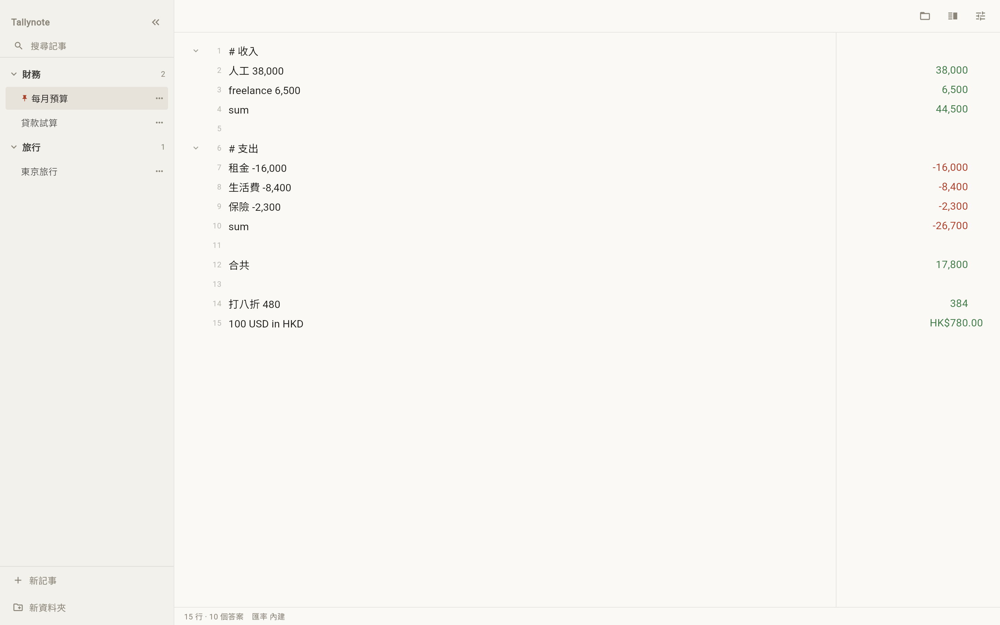
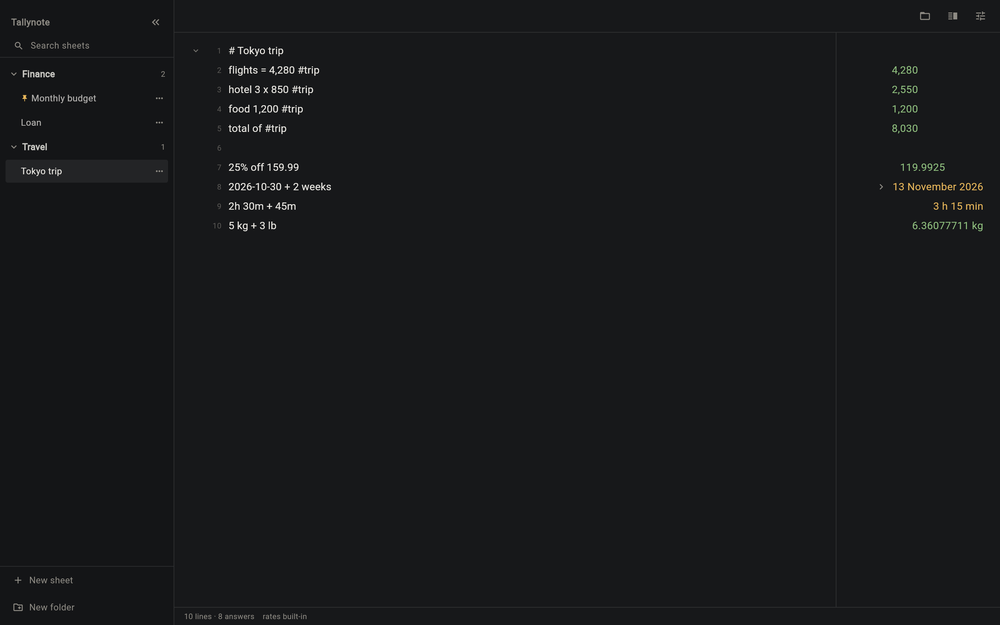
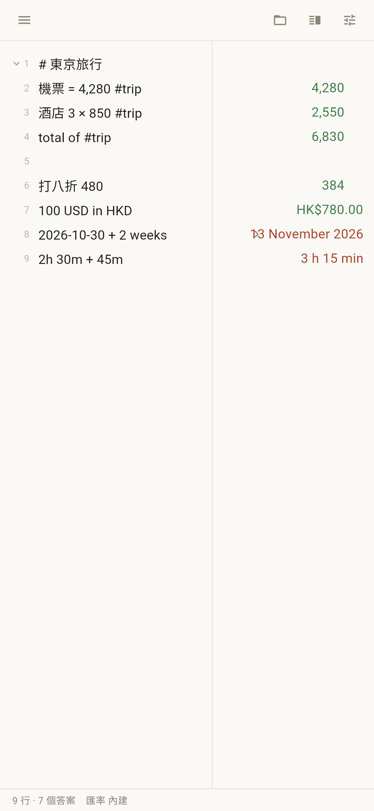

# Numbook · 記事計數簿

**The notepad that adds up.** Every line you type is a calculation; the answer sits on the right, aligned by its decimal point.
**識計數嘅記事簿。** 打一行字就計一次，答案排喺右邊，小數點自動對齊。

Offline first: nothing is computed in the cloud, and the page works with the network unplugged.
離線優先：唔經雲端計算，拔咗網線都照用。

**[Open the web app · 開網頁版](https://kinfxhk.github.io/numbook/)** · **[All downloads · 全部下載](https://github.com/Kinfxhk/numbook/releases/latest)** · **[Buy Me a Coffee](https://buymeacoffee.com/kinfxhk)**

The web app is installable: in Chrome or Edge, **Install Numbook** puts it in the Dock and it opens with the network unplugged. Notes are stored on the device, and closing the tab never loses the last line — the status bar shows *editing…* until the write lands.
網頁版可以安裝：Chrome／Edge 揀「安裝 Numbook」就入 Dock，離線都開得。資料存喺本機，關 tab 唔會蝕最後一行 —— 狀態欄會顯示 *editing…* 直到寫入完成。



## Interface · 介面

- **Sidebar · 側欄** — folders, an unfiled group, search across titles and note bodies, pin and long-press menus. / 資料夾、未分類組、跨標題同內文搜尋、釘選同長按選單。
- **Editor · 編輯區** — one plain text area with line numbers; every line is evaluated as you type. / 一個純文字編輯區加行號，邊打邊計。
- **Answer column · 答案欄** — right-aligned, decimal-aligned, user-sized (drag the splitter, or double-tap to auto-fit). / 右對齊、小數點對齊，可以拖拉調寬，double-tap 自動貼合最長答案。
- **Status bar · 狀態欄** — lines · answers · save state · rate date. One home for save state, never a pop-up card. / 行數、答案數、儲存狀態、匯率日期；儲存狀態只有一個地方顯示，唔會彈卡遮住內容。
- **Header · 頂欄** — exactly two buttons: sheets menu and settings. Every switch lives in a tabbed settings dialog (Appearance / Editor / Data / Cheat sheet). / 只有兩個掣：記事選單同設定；所有開關收喺分頁設定（外觀／編輯／資料／計算表）。

<p>


</p>

Dark theme, English interface and a phone layout are the same build — three languages (English / 繁體中文 / 简体中文) ship in the app and follow the system locale.
深色主題、英文介面、手機排版都係同一個 build；介面內建三種語言（English／繁體中文／简体中文），預設跟系統語言。

## Why it's different · 功能優勢

**1. Offline is a correctness constraint, not a feature bullet.**
No network call can change or block an answer. The only optional fetch is the daily exchange rate, and it can be switched off — the page then makes zero external requests.
**離線係正確性約束，唔係賣點口號。** 冇任何網絡請求可以改變或阻住答案。唯一可選嘅網絡行為係每日匯率，關咗就零外部請求。

**2. Chinese is native input, not a translation layer.**
`打八折 480` → 384, `八五折 200` → 170, `分帳 3 人 380` → 126.666666667, `合共` / `總共` / `加` `減` `乘` `除` `的` `百分之幾` all work next to English syntax.
**中文係原生輸入，唔係翻譯層。** 打八折、分帳、合共、加減乘除、的、百分之幾，同英文語法可以混住用。

**3. Totals built for a balance sheet.**
`sum` per section, `total` / `grand total` / `合共` across the whole note, `total of #tag` for tagged lines. Subtotals are recognised as summaries, so nothing is counted twice.
**小計為資產負債表而設。** 每節 `sum`、全頁 `total`／`grand total`／`合共`、`total of #tag` 逐個標籤加；小計會被當成摘要，唔會重複計。

**4. Every answer can be explained.**
Press the chevron beside a complex answer and it shows each operation in order. When a line is ambiguous the app shows nothing rather than a guess (an uppercase `X` is not a times sign).
**每個答案都解釋得到。** 複雜答案旁邊有箭嘴，逐個運算列出嚟；含糊嘅行寧願唔答，唔會亂猜（大寫 `X` 唔當乘號）。

**5. One engine, five delivery targets.**
The engine is pure Dart with no Flutter imports, so the same rules run on Android, Windows, Linux and the web — and compile to a single CLI binary for scripts and agents.
**一個引擎，五個交付方式。** 引擎係純 Dart、唔依賴 Flutter，同一套規則行 Android、Windows、Linux、Web，仲可以編譯成單一 CLI binary 俾 script 同 agent 用。

**6. The cheat sheet cannot lie.**
Settings → Cheat sheet (計算表) lists every word you can type with the answer it really gives — and a test evaluates every row, so the page cannot drift away from the engine.
**計算表唔會講錯。** 設定 → 計算表列出所有打得嘅字同真正答案，而且有測試逐行驗算，頁面唔會同引擎走樣。

## What it does · 功能

```
rent = 2500                    →  2,500
food = 400                     →  400
rent + food                    →  2,900

# Trip to Tokyo
flights = 4,280 #trip          →  4,280
hotel 3 × 850 #trip            →  2,550
total of #trip                 →  6,830

100 USD in HKD                 →  HK$780.00
5 kg + 3 lb                    →  6.36077711 kg
25% off 159.99 + 10% tax       →  131.99175
9 is to 16 as 27 is to what    →  48
2026-10-30 + 2 weeks           →  13 November 2026
3pm HKT in New York            →  30 October 2026 at 3:00 AM
6+3x30                         →  96
30乘3                           →  90
```

**Calculating · 計算**
- Line-by-line answers; a broken line never breaks the page. A blank line is spacing, not a section break: `total` still counts the lines above it. / 逐行答案，壞咗一行唔會拖死成頁；空行只係間距，`total` 照計上面所有行。
- Variables (`rent = 2500`), references (`prev`, `line 3`), `sum` / `average` / `count` per section. / 變數、引用（`prev`、`line 3`）、每節 `sum`／`average`／`count`。
- Percentages in plain words: `15% of 300`, `25% off 159.99`, `20 is what % of 80`, `5% of what is 150`, plus Chinese retail forms. / 口語百分比，加中文零售寫法。
- Remainders: `7 % 2` or `10 mod 3` → 1 (a `%` with a number after it is never a percentage). / 餘數；`%` 後面有數字就係取餘，唔會當百分比。
- Scale words: `1.5 million + 200 thousand` → 1,700,000; `$30/day is what per year` → $10,950.00. / 數量級字眼同年化。
- Units (length, mass, area, volume, speed, time, data, angle, temperature); mixed units convert on the fly. / 單位換算，混單位即時轉。
- Currency with daily ECB rates, cached for offline use. / 貨幣用 ECB 每日匯率，快取咗離線都用得。
- Dates, durations and time zones: `today + 3 workdays`, `2026-10-31 - 2026-01-01` → 303 days, `3pm HKT in New York`. / 日期、時長、時區。
- `if … then … else`; rule of three; compound interest; scientific notation (`1e3`). / 條件式、三數法、複利、科學記數。
- Functions in any shape people type them: `sin 30 deg`, `sin30deg`, `max(1, 9, 4)`, `round 3.14159 2`, `pi`. / 函數點打都認。

**Totals that suit a balance sheet · 資產負債表式小計**

```
# Assets
cash 500,000                   →  500,000
stocks 300,000                 →  300,000
sum                            →  800,000

# Liabilities
mortgage -500,000              →  -500,000
cards -20,000                  →  -20,000
sum                            →  -520,000

合共                             →  280,000
```

`total` / `sum` can be used inside an expression too (`total * 7.8 + 16000`), and money plus a plain number is read in that currency.
`total`／`sum` 亦可以擺入算式（`total * 7.8 + 16000`）；金錢加純數字會用返該貨幣。

**Reading real-world notes · 讀真實筆記**
- `Topstep: −$10,408.52` — the label stays out of the maths, the unicode minus keeps its sign, money keeps its cents. / 標籤唔會入算式，unicode 負號保留，金額保留仙位。
- `// any line` becomes a draft: greyed, not calculated. / `//` 開頭變草稿：變灰、唔計。
- `**bold**`, `_italic_`, `~~strike~~`, `__underline__`, `{red}colour{/}` — select text and use the small format bar; markers are plain text, so the file stays portable and the maths still works. / 格式標記係純文字，檔案照樣帶得走，計算照跑。

**Workspace · 工作區**
- Folders in the sidebar, with an unfiled group for everything else. / 側欄資料夾，其餘歸「未分類」。
- Search across titles and note bodies; folders flatten while a query is active. / 搜尋標題同內文；有搜尋字時資料夾會攤平。
- Long-press a sheet to move or delete it; long-press a folder to rename or delete it — deleting a folder keeps its sheets. / 長按記事可移動或刪除；長按資料夾可改名或刪除 —— 刪資料夾唔會刪記事。

**Answers you can trust · 可信答案**

```
(2.5+7.5)*1.11/10-15^2
    2.5 + 7.5 = 10
    10 * 1.11 = 11.1
    11.1 / 10 = 1.11
    15 ^ 2 = 225
    1.11 - 225 = -223.89
```

**Shortcuts · 快捷鍵** — `⌘/Ctrl+S` save (flushed, with visible confirmation), `⇧S` strikethrough, `⇧D` duplicate, `B`/`I`/`U` wrap, `F` search, `W` close tab, `N` new sheet, `\` sidebar, `⇧A` answers, `+`/`-`/`0` zoom, `Ctrl/⌘ + wheel` or trackpad pinch to zoom the whole layout (100–200 %).
`⌘/Ctrl+S` 儲存（即時寫入並顯示確認）、`⇧S` 刪除線、`⇧D` 複製記事、`B`／`I`／`U` 包格式、`F` 搜尋、`W` 關 tab、`N` 新記事、`\` 側欄、`⇧A` 答案、`+`／`-`／`0` 縮放、`Ctrl/⌘ + 滾輪` 或觸控板捏合縮放整個版面（100–200%）。

## Install · 下載

| Platform · 平台 | Download · 檔案 | Notes · 說明 |
|---|---|---|
| Android | `app-release.apk` | signed with the release key · 用 release key 簽署 |
| Windows | `Tallynote-<version>-setup.exe` | per-user install, Start-menu shortcut, uninstaller · 單用戶安裝、開始選單捷徑、反安裝 |
| Windows (portable) | `tallynote-windows.zip` | unzip and run `tallynote.exe` · 解壓即用 |
| Linux | `tallynote_<version>_amd64.deb` | installs to `/usr/lib/tallynote` with a desktop entry · 裝到 `/usr/lib/tallynote` 並加桌面捷徑 |
| Linux (portable) | `tallynote-linux.tar.gz` | unpack and run `bundle/tallynote` · 解壓即用 |
| Web | [kinfxhk.github.io/numbook](https://kinfxhk.github.io/numbook/) | deployed from `main`, installable as a PWA · 由 `main` 部署，可安裝成 PWA |
| macOS / iOS | not yet · 未有 | needs a full Xcode install · 要完整 Xcode |
| Linux / Windows arm64 | not yet · 未有 | Flutter publishes no arm64 host SDK (flutter/flutter#114349) · Flutter 未有 arm64 host SDK |

Every release also ships `SHA256SUMS.txt`; the version is in the file names above as `<version>`.
每個 release 都附 `SHA256SUMS.txt`；上面 `<version>` 位置就係版本號。

Binary names still carry the old `tallynote` prefix (installer, `.deb` package, executable) on purpose: renaming them breaks the sign-in/update path of existing installs, so they change in one coordinated packaging pass, not here.
執行檔名仍然沿用舊 `tallynote` 前綴（安裝程式、`.deb` 包名、執行檔）：改名會斷開現有安裝同更新路徑，所以留到下一次整體打包改動才處理。

## From the command line · 命令列

The engine is pure Dart, so it also compiles to a single binary — handy for scripts and agents:
引擎係純 Dart，可以編譯成單一 binary，方便 script 同 agent：

```bash
dart compile exe bin/tallynote.dart -o build/tallynote
./build/tallynote "5 kg + 3 lb"
./build/tallynote -f budget.txt --json --total --strict
```

`--json` returns `value` (typed) alongside `display`; `--strict` turns off the human-friendly guessing so a broken line is an error. See [docs/agents.md](docs/agents.md) for the agent/MCP plan.
`--json` 會同時回傳 `value`（帶型別）同 `display`；`--strict` 關掉人性化猜測，壞行就報錯。Agent／MCP 計劃見 [docs/agents.md](docs/agents.md)。

## Design principles · 設計原則

1. **Offline is correct.** No network call can change an answer. The only optional fetch is the daily rate refresh, and it can be switched off in Settings. / **離線即正確。** 冇網絡請求可以改變答案；唯一可選嘅係每日匯率更新，設定可以關。
2. **One meaning, one trigger.** A word belongs to exactly one feature; the precedence ladder and a machine-checked trigger registry keep new features from colliding. / **一個意思一個觸發。** 每個字只屬於一個功能；優先次序表同機器檢查嘅觸發登記防止新功能撞車。
3. **No answer beats a wrong answer.** / **唔答好過答錯。**

## Build · 建置

```bash
flutter pub get
flutter test
flutter run -d android     # or linux, windows, chrome
flutter build apk --release
flutter build web --release --base-href /numbook/ --no-web-resources-cdn
```

Windows needs the **Desktop development with C++** workload:
Windows 需要 **Desktop development with C++** 工作負載：

```powershell
winget install --id Microsoft.VisualStudio.2022.BuildTools -e --silent `
  --override "--wait --quiet --add Microsoft.VisualStudio.Workload.VCTools --includeRecommended"
flutter build windows --release
```

`--no-web-resources-cdn` matters: CanvasKit is served from the bundle, so opening the page touches no CDN. CI builds Android, Linux, Windows and Web on every push; the Windows `tallynote.exe` in the release was built and run natively on Windows 11.
`--no-web-resources-cdn` 有作用：CanvasKit 由 bundle 提供，開頁唔會掂 CDN。每次 push CI 都會建 Android、Linux、Windows、Web；release 內嘅 Windows `tallynote.exe` 係喺 Windows 11 原生建置同運行過。

## License · 授權

MIT. Tallynote is an independent implementation of the notepad-calculator idea, and is not affiliated with any commercial notepad calculator.
MIT。Tallynote 係記事計算機概念嘅獨立實作，同任何商業記事計算機無關聯。
